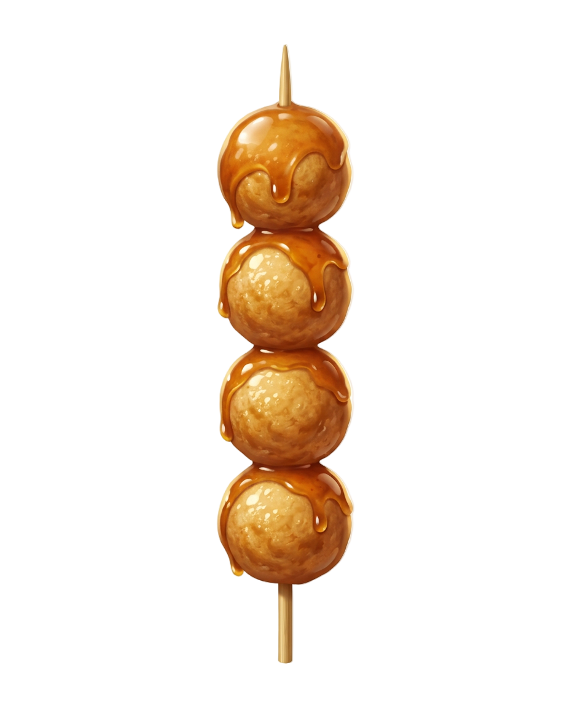
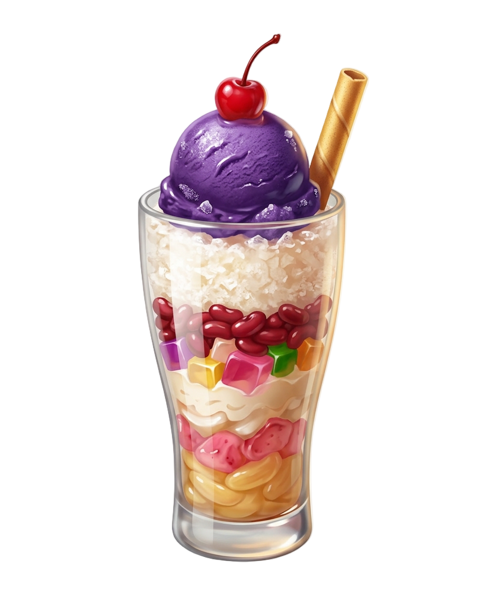
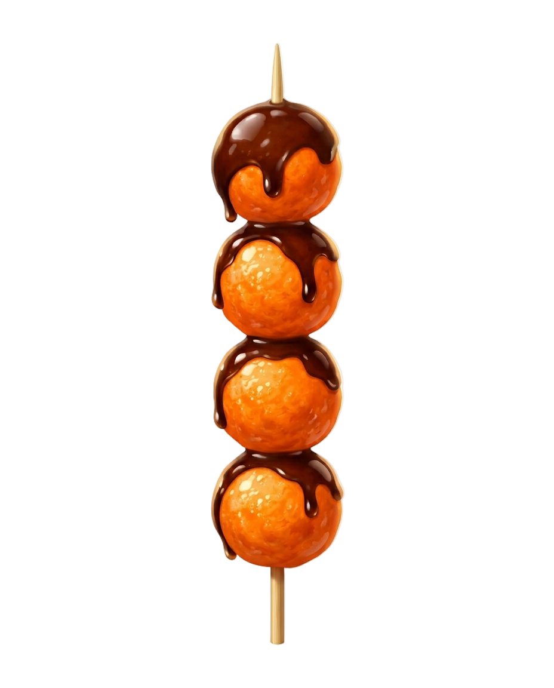
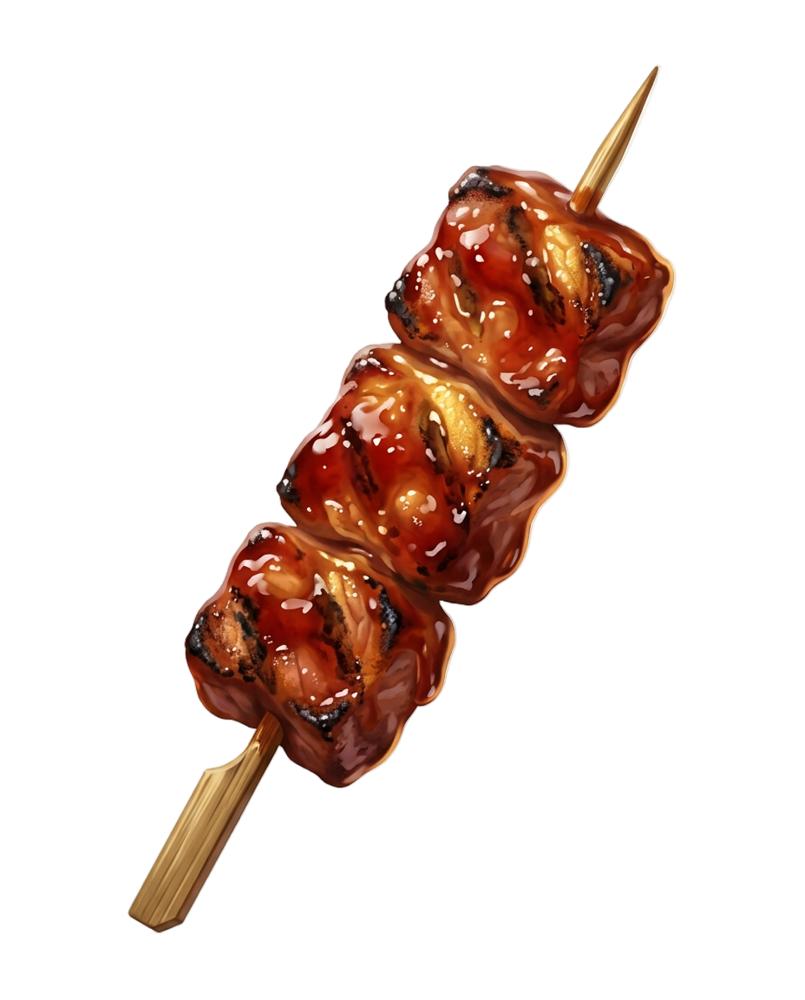
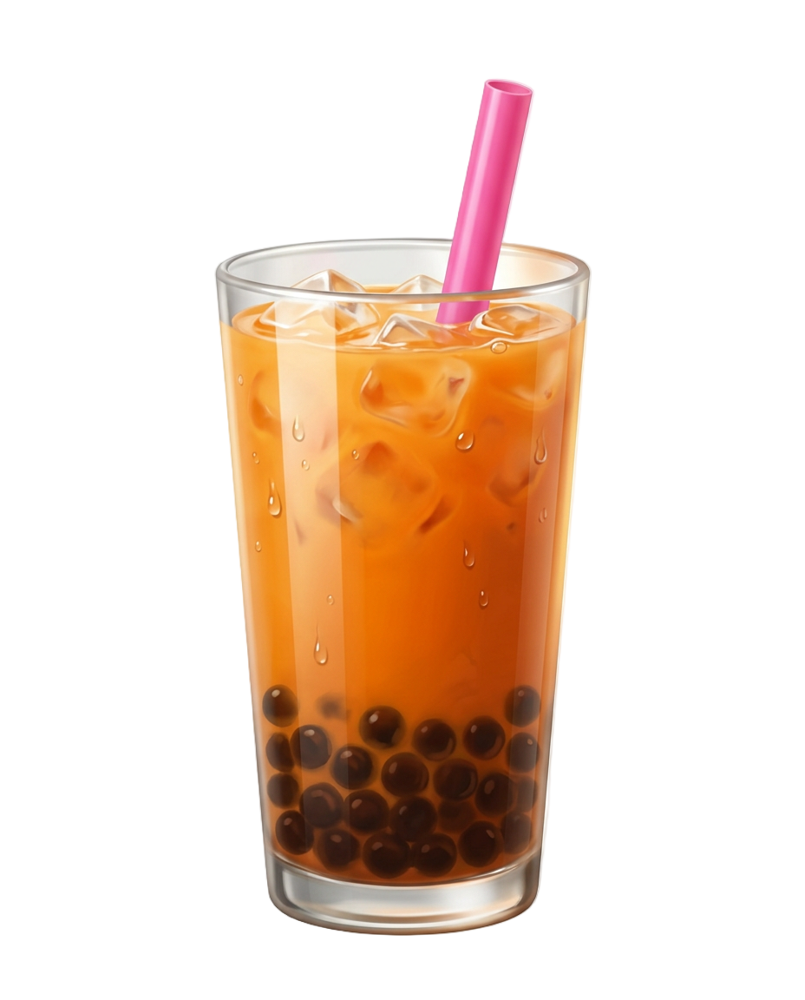
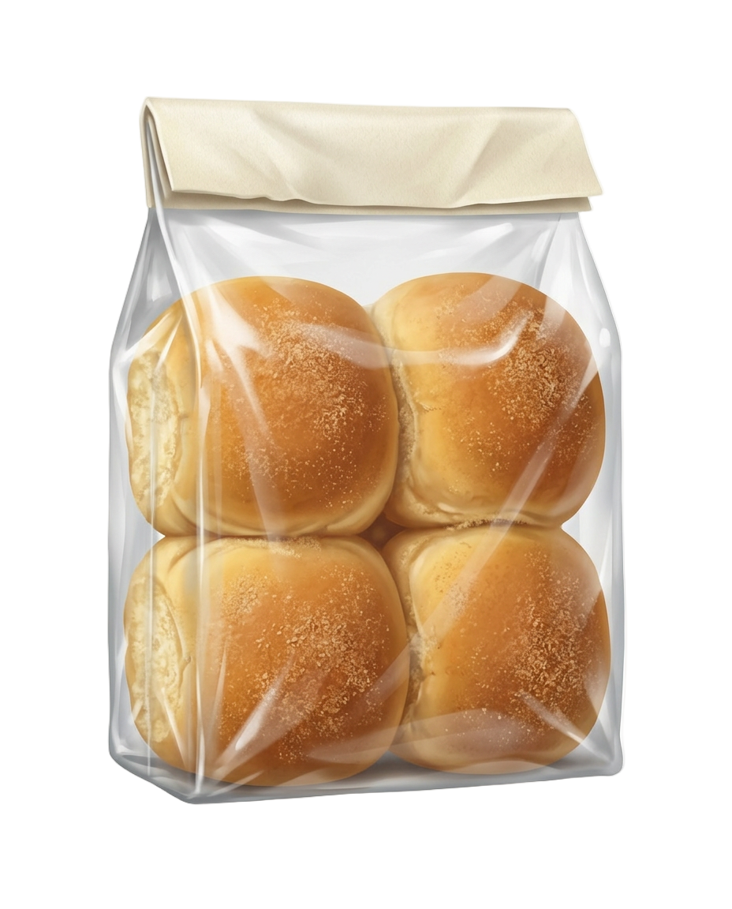
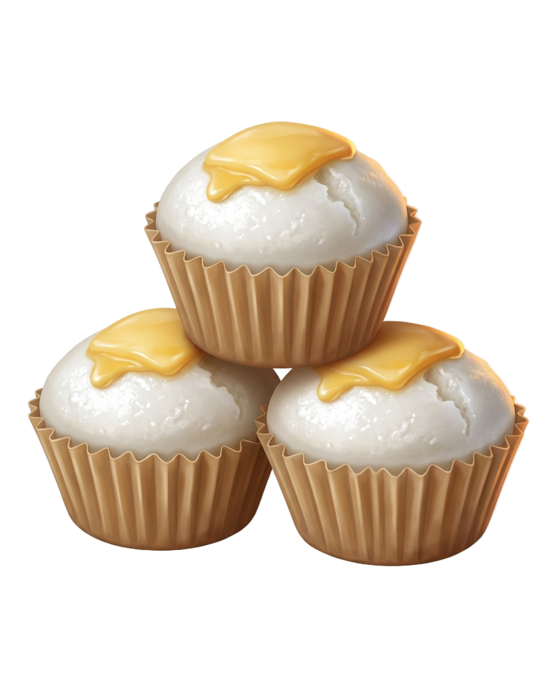
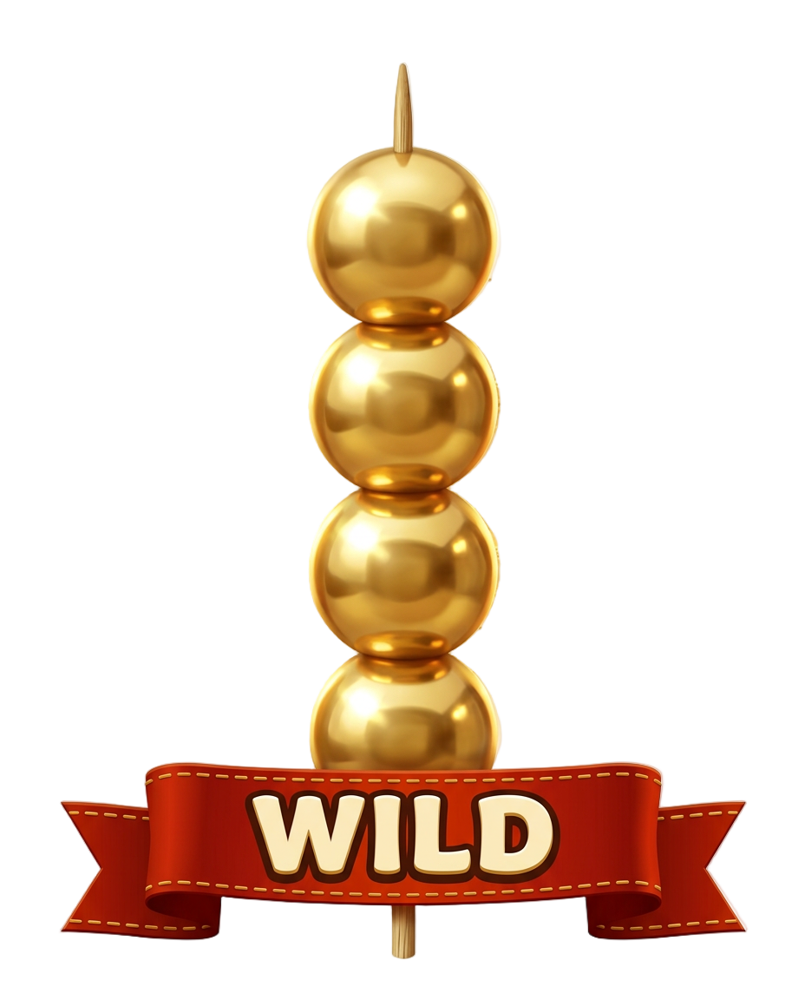
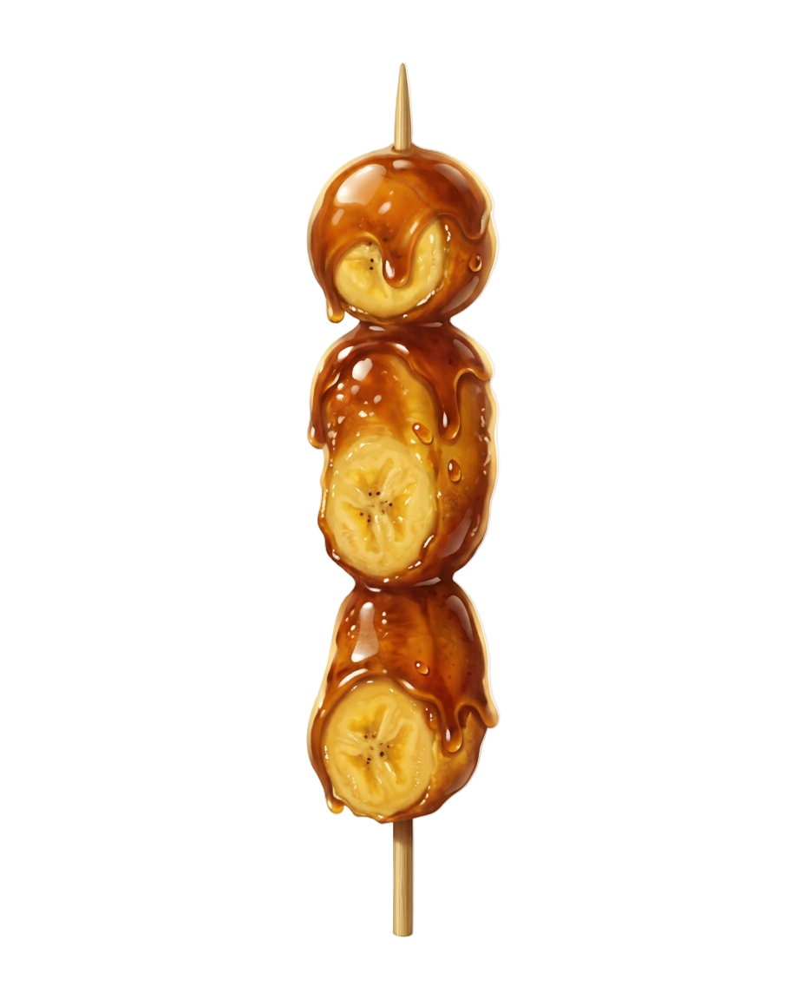
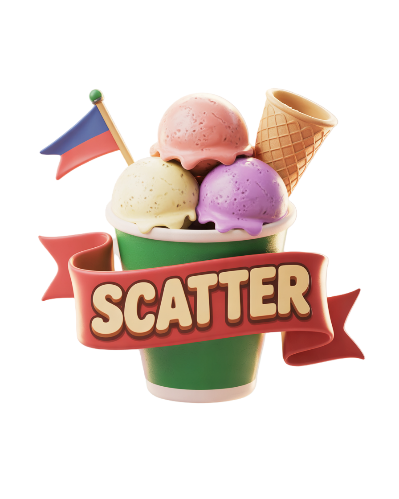

# Art log: Fishball Fiesta (game 001)

Prompts, models, decisions and the images behind them. Newest at the bottom. New entries are added with
`npm run art:log` (see `agents/art-log.md`). The first entries below were written from memory of the
2026-11-12/13 sessions; images are the originals in `../source/`.

---

## 2026-11-12 · style
**Decision (Josh):** Update the symbols to the look of the first reference screenshot (semi-realistic, glossy rendered food). The reference is a guide only.
**Why:** The placeholder art was a flat sticker style (thick dark outline, flat colour). Josh wanted the glossy look of a polished slot. Our symbols must stay original, so the look was written as words in `theme/style.json` (semi-realistic 3D render, soft studio light from the top left, warm rim light, specular highlights) and the reference image was not sent to any model. The old sticker look is kept in the notes of `style.json`.

---

## 2026-11-12 · process
**Decision (Josh):** Show the suggested model and the cost before generating anything, then wait for "go".
**Why:** Credits are prepaid and spent per image. Josh created a custom fal API key (Models/Requests READ, SUBMIT, CANCEL only; short expiry; limited allowed models) kept in `.env.local`, and also connected the fal connector for chat experiments.
**Rule:** nano-banana-2 $0.08/image, background removal under a cent, Ideogram v3 about $0.03.

---

## 2026-11-12 · sym_H1 (hero symbol)
**Decision (Josh):** "Let's start with A" (candidate A of two).
**Why:** Candidate A had sauce on all four balls and a clean even silhouette. Candidate B left the top ball bare (looked unfinished).
**Cost:** about $0.16 for 2 candidates, plus a cutout.
**Model:** fal-ai/nano-banana-2, 4:5, 1K, 2 images, then fal-ai/birefnet for the transparent background.

<details><summary>Prompt</summary>

```text
PURPOSE: High-value slot symbol icon for a mobile game, must read in half a second at 128 px.
SUBJECT: Four round golden-brown fishballs on a single bamboo skewer, glossy with thick sweet amber sauce dripping slightly.
COMPOSITION: Front view, skewer vertical and centred, the food fills about 85 percent of the height, small even margin on all sides, strong simple silhouette.
STYLE: Semi-realistic 3D rendered food illustration, glossy and appetising, detailed surface texture, soft rounded shapes, polished mobile slot game symbol look.
LIGHTING: Soft studio key light from the top left, warm rim light, a gentle darker shadow side, bright specular highlights on the sauce.
PALETTE: Rich saturated golden browns and amber with warm cream tones; no blue.
CONSTRAINTS: No text. No watermark. No real brand names. No cartoon outline. No ground shadow. Isolated on a plain flat white background with a clean edge, nothing behind the subject.
```

</details>

**Picked:**



---

## 2026-11-12 · sym_H2 to sym_H4, sym_L1 to sym_L4, sym_WILD (the rest of the set)
**Decision (Josh):** Approved the plan: make the other symbols with the approved H1 as a style reference so the set matches.
**Cost:** about $0.64 for 8 images, about $0.05 for the cutouts.
**Model:** fal-ai/nano-banana-2/edit with H1 as `image_urls`; prompt opens with "Use image 1 for the rendering style only ... Do not copy its subject." Each symbol keeps the same STYLE/LIGHTING/CONSTRAINTS lines as H1; the SUBJECT lines are in `theme/prompts/sym_*.json`:
H2 halo-halo glass with ube scoop; H3 kwek-kwek on one skewer; H4 barbecue pork skewer; L1 banana cue; L2 sago't gulaman cup; L3 pandesal in a bag; L4 puto in pleated cups; WILD gold fishball skewer, sparkles, red ribbon reading "WILD".

**Picked:**

      

---

## 2026-11-12 · sym_L1 (banana cue)
**Decision (Josh):** Fix the banana cue: it showed two sticks at the bottom and only one at the top. One stick only, like the fishball and barbecue.
**Why:** Regenerated with the instruction repeated twice ("exactly one stick ... never two", "No second stick", "No forked or doubled skewer"). Two candidates: candidate 1 had one stick but looked like fishballs, so it was rejected; candidate 2 shows banana slices in caramel with one stick through the top and bottom, so it was picked.
**Cost:** about $0.16 plus a cutout.
**Model:** fal-ai/nano-banana-2/edit, H1 as style reference.

**Picked:**



---

## 2026-11-13 · atlas fitting
**Decision (Josh):** New images must have the same size and position as the original atlas, so they can be dropped straight into the game; the previous art must not show in the background.
**Why:** The original atlas has 256x256 cells and the art touches the cell edge on its longer side, centred. `npm run art:symbols` now fits every symbol that way and rebuilds the atlas. A first version left the old art showing through (the clearing step used a transparent rectangle); fixed with an opaque one. A copy of the fixed script reached Josh's PC late because of a stale network mount copy; confirmed afterwards that atlas cells equal the single frames.

---

## 2026-11-13 · sym_SC (scatter)
**Decision (Josh):** Proceed with the scatter, then "I like B more".
**Why:** The scatter must read "SCATTER" on a banner like the reference, with our own design: a sorbetes cup with three scoops, cone wafer, small flag and a chilli-red ribbon. Ideogram v3 was used because it spells text best; both candidates spelled SCATTER correctly. B shows the whole cup and has a more complete look.
**Cost:** about $0.07 including the cutouts.
**Model:** fal-ai/ideogram/v3, 1024x1280, QUALITY, `expand_prompt: false`, seed 922446209.

<details><summary>Prompt</summary>

```text
Scatter symbol for a mobile slot game that starts free spins, as eye-catching as the Wild, for a Filipino street food themed game. A tall cup of sorbetes (dirty ice cream) with three pastel scoops, a cone wafer and a small flag, with a bold ribbon banner across the lower third. Front view, centred, banner fully inside the frame, fills about 90 percent of the height, small even margin. The word "SCATTER" in chunky bold cream letters with a thick dark-brown outline, on a chilli-red ribbon banner. Semi-realistic 3D rendered food illustration, glossy and appetising, detailed surface texture, soft rounded shapes, polished mobile slot game symbol look. Soft studio key light from the top left, warm rim light, a gentle darker shadow side, bright specular highlights. Pastel pink, purple and cream ice cream, green cup, chilli-red banner. Isolated on a plain flat white background with a clean edge, nothing behind the subject, no ground shadow. No other text.
```

</details>

**Picked:**



---
